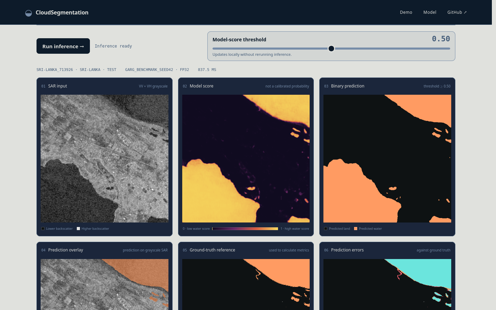

# CloudSegmentation

[](https://github.com/IngKP/CloudSegmentation/actions/workflows/ci.yml)

**CPU-deployed Sentinel-1 surface-water segmentation with ONNX Runtime, FastAPI, Docker, private GCS artifact staging, and Google Cloud Run.**

[Live demo](https://cloudsegmentation-622822429157.asia-northeast1.run.app/) · [Model selection](docs/model-selection.md) · [Cloud deployment](docs/phase5-cloud-deployment.md) · [Performance evidence](docs/phase6-performance.md)

CloudSegmentation turns an existing remote-sensing research model into a small production-style inference service. The project covers model selection, ONNX export and fidelity checks, API serving, browser-side threshold exploration, containerization, private artifact handling, deployment, and operational verification.



> **Scope:** Sen1Floods11 provides an all-water reference mask on flood-event scenes. This project therefore demonstrates **surface-water segmentation**, not validated transient-flood mapping, calibrated risk probabilities, or operational flood-response readiness.

## Highlights

| Area | Result |
| --- | --- |
| Model selection | Evaluated four deployment candidates; selected a 5-channel cross-modal Swin-UNet student |
| Accuracy evidence | Archived 90-chip, three-seed all-water IoU: **0.7045** |
| Deployment artifact | Fixed-shape FP32 ONNX, **134.95 MB** |
| ONNX fidelity | Maximum score error **2.98e-6** vs PyTorch on two export-verification scenes; **100%** mask agreement at threshold 0.5 |
| Local ORT estimate | **767 ms p50** with one CPU thread in the focused export benchmark |
| Cloud serving | FastAPI + ONNX Runtime in Docker on Google Cloud Run, CPU only |
| Artifact boundary | Model and curated sample objects remain in private GCS and are checksum-verified at startup |
| Cost/abuse controls | Scale-to-zero, max one instance, concurrency one, bounded prediction cache, server-side prediction rate limit |
| Interactive analysis | Threshold changes rerender predictions and metrics in the browser without rerunning inference |

The local and Cloud Run latency numbers come from different environments and protocols; they should not be compared as if they were the same benchmark. See the linked evidence documents for methodology and limitations.

## Architecture

```text
Browser
   │
   ▼
Cloud Run
FastAPI + frontend
   │
   ├── ONNX Runtime → Swin-UNet
   │
   └── private GCS
       model + curated samples
```

Production uses one CPU, 2 GiB memory, request-based billing, minimum instances 0, maximum instances 1, and container concurrency 1. The browser never receives the private ONNX model or source sample objects.

## Demo workflow

The public demo exposes two curated Sentinel-1 scenes for interface and export verification:

1. Select a scene.
2. Run CPU inference on the deployed FP32 ONNX model.
3. Inspect SAR input, model score, binary prediction, overlay, ground truth, and error map.
4. Move the score threshold to update the mask and IoU/precision/recall locally.

The two scenes are intentionally **not** presented as representative benchmark samples. Dataset-level model selection uses the archived three-seed IoU evidence documented in [`docs/model-selection.md`](docs/model-selection.md).

## Model selection

Four candidates were compared before deployment:

| Architecture | Channels | Three-seed IoU | Focused CPU estimate |
| --- | ---: | ---: | ---: |
| U-Net | 2 | 0.6804 | 32,753 ms p50 |
| U-Net | 5 | 0.6820 | 17,958 ms p50 |
| ResNet34-U-Net | 5 | 0.6794 | 2,529 ms p50 |
| **Cross-modal Swin-UNet student** | **5** | **0.7045** | **214 ms p50** |

The selected model uses VV, VH, DEM, HAND, and a WorldCover water-prior channel. The coarse PyTorch CPU screen above was used only for candidate selection; the exported FP32 ONNX model was then measured separately with ONNX Runtime. Full protocol and quantization results are in [`docs/model-selection.md`](docs/model-selection.md).

## Stack

- **ML / inference:** NumPy, ONNX Runtime, Pillow
- **API:** FastAPI, Uvicorn
- **Frontend:** HTML, CSS, vanilla JavaScript, Canvas API
- **Packaging:** Python 3.12, `uv`, Docker
- **Cloud:** Google Cloud Run, Artifact Registry, Cloud Storage, IAM, Cloud Logging/Monitoring
- **Quality:** pytest, Ruff, GitHub Actions

## Reproducibility

Python **3.12** is required.

The canonical environment is the committed `uv.lock` file:

```bash
uv sync --locked
uv run --locked pytest
uv run --locked ruff check .
```

A pip-compatible [`requirements.txt`](requirements.txt) is also provided with the direct runtime dependencies pinned to the versions resolved in `uv.lock`:

```bash
python -m venv .venv
source .venv/bin/activate
python -m pip install -r requirements.txt
```

For exact transitive dependency reproduction, prefer `uv sync --locked`.

Run the serving application with:

```bash
uv run --locked uvicorn app.main:app --host 127.0.0.1 --port 8080
```

The repository intentionally does **not** include the research checkpoints, ONNX binary, or Sen1Floods11 sample NPZ files. Production obtains the approved artifacts from private GCS and verifies their expected sizes and SHA-256 hashes against the tracked manifests before loading them. This keeps the source repository publish-safe while preserving artifact provenance.

## API

| Route | Purpose |
| --- | --- |
| `GET /health` | Service/model metadata |
| `GET /samples` | Curated sample list |
| `GET /samples/{id}/sar.png` | Prepared SAR visualization |
| `GET /samples/{id}/reference.png` | Prepared reference mask |
| `POST /predict` | ONNX inference for a curated sample ID |

`POST /predict` returns a lossless model-score map plus a browser-oriented score preview. Score values are model sensitivity values, **not calibrated probabilities**.

## Deployment and performance

The public service is deployed to Google Cloud Run in `asia-northeast1`. Model and sample objects remain private in GCS; the Cloud Run runtime identity has bucket-scoped read access and stages verified artifacts into ephemeral storage at instance startup.

The deployment includes:

- immutable commit-tagged container images in Artifact Registry,
- private artifact storage with public access prevention,
- attached runtime service identity rather than service-account key files,
- scale-to-zero with a one-instance service cap,
- one-request container concurrency,
- in-process fixed-sample response caching,
- a process-wide prediction rate limit,
- Cloud Logging/Monitoring verification.

Historical deployment measurements and their limitations are recorded in [`docs/phase6-performance.md`](docs/phase6-performance.md). They are portfolio engineering evidence, not an SLA or capacity claim.

## Repository layout

```text
app/          FastAPI service, inference, staging, cache/rate-limit integration
frontend/     Interactive browser UI
manifests/    Tracked model/sample metadata and integrity information
scripts/      Verification, export/benchmark support, and deployment test utilities
docs/         Model-selection, deployment, and performance evidence
deploy/       Non-secret GCP configuration example
Dockerfile    Publish-safe CPU serving image
```

## Data and model boundary

The source code is MIT licensed. Dataset and model artifacts are not covered by that license.

The demo attributes [Sen1Floods11](https://github.com/cloudtostreet/Sen1Floods11) to Cloud to Street and Bonafilia et al., *Sen1Floods11: A Georeferenced Dataset to Train and Test Deep Learning Flood Algorithms for Sentinel-1* (CVPR Workshops, 2020). The upstream repository does not state an explicit dataset license; the public demo therefore does not represent citation as redistribution permission.

## License

Source code: [MIT License](LICENSE).
